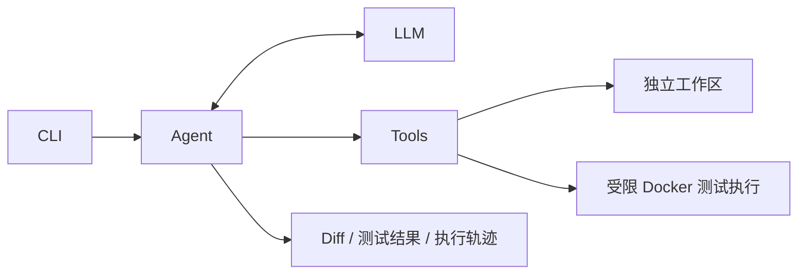

# MVP 架构（设计目标）

当前仅实现包入口和配置。以下内容是 Phase 1 的设计约束，接口会在对应任务中通过测试细化。

## 模块职责

| 模块 | 职责 | 边界 |
| --- | --- | --- |
| CLI | 解析任务输入、启动执行、展示报告 | 不包含模型或工具实现 |
| Agent | 状态、上下文、有限步骤的决策循环 | 通过模型 / 工具接口工作，不直接运行 Shell |
| LLM | 消息与工具调用转换、Fake、兼容 API | 不处理文件或仓库执行 |
| Tools | 参数校验、工具注册、结构化结果 | 只访问已分配的工作区 |
| Sandbox | 独立工作区、受限 pytest 执行与清理 | 不允许模型决定任意宿主命令或挂载 |
| Config | 环境变量与配置验证 | 不在导入时联网或创建工作区 |

## 数据与接口设计

- `TaskState`：task_id、repository、user_request、status、current_step、messages、tool_calls、artifacts、error、created_at、updated_at。
- `ModelResponse`：助手消息、工具调用、可选用量和耗时；Fake 与真实模型共享接口。
- `ToolCall`：调用 ID、工具名、参数；按工具独立的 Pydantic schema 校验。
- `ToolResult`：调用 ID、成功状态、结构化输出、错误、耗时；记录输出是否截断。
- `ExecutionResult`：退出码、stdout、stderr、耗时、是否超时、是否为 Mock。

初期采用 Python Protocol 描述外部依赖，Pydantic 描述边界数据。具体异步签名在模型接口任务中确定；不提前建立通用框架。

状态初步为 PENDING、RUNNING、COMPLETED、FAILED、CANCELLED。WAITING_APPROVAL 在人工审批功能落地时加入；实现时集中校验转换。达到步数上限、执行失败或验证不足不能伪装成成功修复。任务结束状态与修复验证结论分开记录。

## 执行与安全约束

- 用户目标仓库作为只读输入，在独立副本中修改，不共享可写 Git 元数据。
- 文件读取、搜索和补丁处理必须校验工作区边界，并处理符号链接等越界情况。
- 仓库文件、任务文本、模型输出和工具输出均是不可信数据。
- 运行目标仓库测试需要 Docker：非 root、默认无网络、限制 CPU / 内存 / 进程数、设定超时，挂载仅限该任务工作区。
- 缺少 Docker 时明确报告不可执行，或选择标记清楚的 Mock；不能降级为不受限的宿主执行。
- 配置默认超时不代表已落实隔离；执行器实现后需要独立的集成测试验证限制。
- 最终只交付补丁与报告，是否应用修改由用户决定。

## 评测边界

Fake 用于确定性验证循环和错误处理；真实模型调用与 Docker 测试用于实际修复演示。
分别记录“模型声称完成”“代码可运行”“现有测试通过”“目标问题被独立测试证实修复”。
没有实际运行，就不报告完成率、token 或其他 benchmark 数字。

## 后续阶段

API、数据库、任务恢复、Web 页面与批量评测不属于当前骨架。模块在实际使用时再增加，避免提前引入空的后端层或任务队列。
